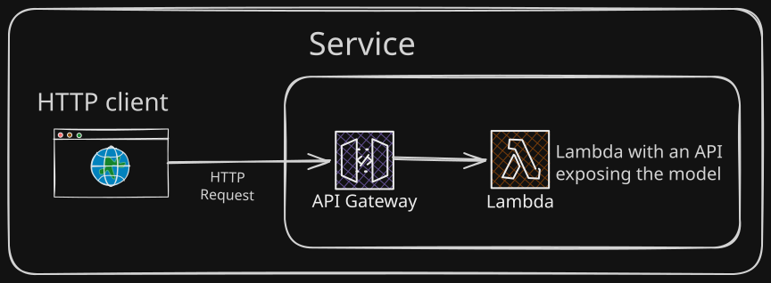

# Infrastructure

The delivery risk API will run on AWS. The client will send the data available at order approval over HTTPS. Amazon API Gateway will forward the request to AWS Lambda, which will return the estimated probability that the order arrives after its promised delivery date.

## AWS services

#### Amazon API Gateway

API Gateway will provide the HTTPS endpoint, forward each prediction request to the Lambda function, and return the response to the client. [API Gateway integration with Lambda](https://docs.aws.amazon.com/apigateway/latest/developerguide/http-api-develop-integrations-lambda.html)

#### AWS Lambda

The function will preprocess the order data and run the logistic regression model selected in the notebook. Lambda runs inference on each request without requiring a dedicated API server. [Modeling notebook](../notebooks/03_modeling.ipynb) · [AWS Lambda](https://docs.aws.amazon.com/lambda/latest/dg/welcome.html)

## Verify the deployment

After deployment, send a sample order to the endpoint and check that the API returns HTTP 200 and a probability between 0 and 1. Compare the response with the local prediction for the same input and model version.
